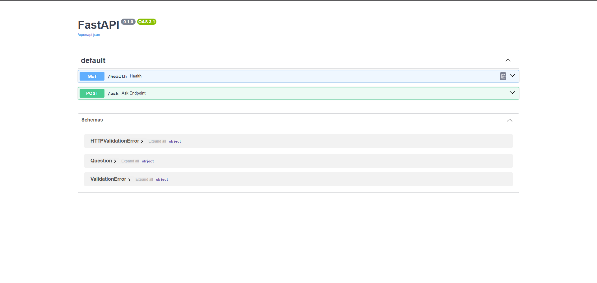
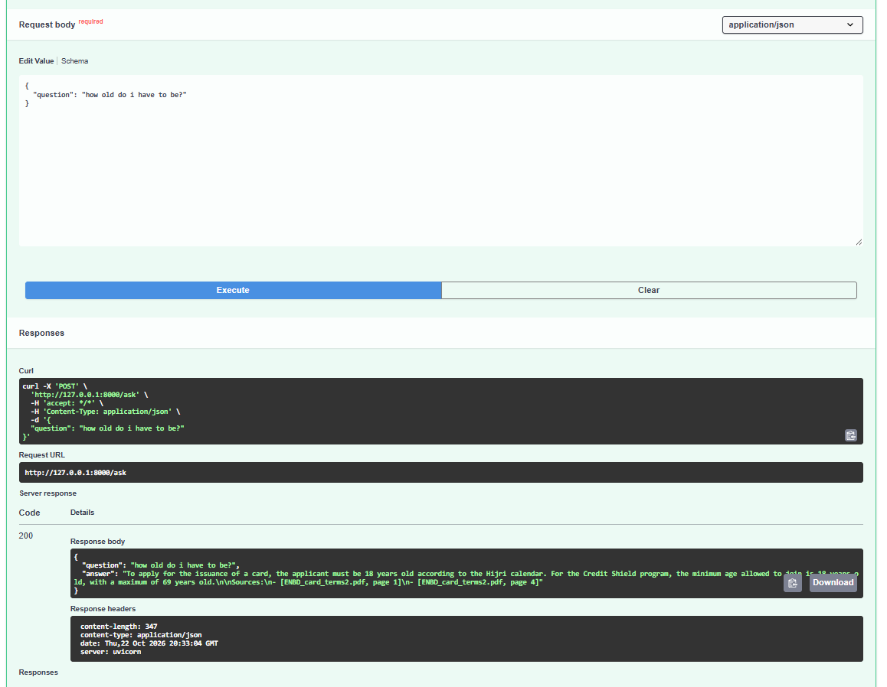

#  Bank Policy Q&A (RAG API)

Ask questions about bank documents in plain English and get answers **with the exact source and page**.

 Instead of wasting valuable time, search will be made easy and in seconds, No need to go through tens of pages to find a piece of information.

## Demo

**Question:** What happens if I pay late?
**Answer:** The bank charges a late payment fee after a 23-day grace period, plus financial charges on unpaid transactions.
**Source:** ENBD_card_terms2.pdf, page 3

**Question:** What is the price of an iPhone?
**Answer:** I don't know. (It doesn't make anything up, guarantees that it won't provide information not inside the document)




## How it works

1. **Read** PDFs and clean the text, keeping file name and page number
2. **Chunk** the text into small overlapping pieces (LangChain)
3. **Embed** each chunk into numbers that capture meaning (BAAI/bge-small-en-v1.5)
4. **Store** the chunks in a vector database (ChromaDB)
5. **Search** for the chunks closest in meaning to the question
6. **Answer** with Gemini, using only those chunks, and cite the source
7. **Serve** it all through a REST API (FastAPI)

## Tech stack

Python · LangChain · Sentence-Transformers · ChromaDB · Google Gemini · FastAPI · Pytest · Docker · Git

## Run it

**With Docker:**
```
docker build -t bank-policy-qa .
docker run -p 8000:8000 --env-file .env bank-policy-qa
```
Then open http://127.0.0.1:8000/docs

You need a `.env` file with your key: `GEMINI_API_KEY=your-key`

**Run tests:**
```
pytest
```

## What I learned

- **Debugging retrieval:** the app answered "I don't know" to a question the PDF *did* answer. I checked whether search or the AI was failing, confirmed the text existed, and fixed it by upgrading the embedding model.
- **Handling failures:** added a backup model so the API returns a friendly message instead of crashing when the AI service is busy.
-   **Better chunking:** my first chunker cut words in half, so I switched to LangChain's splitter, which breaks text at paragraphs and sentences instead.
- **Keeping secrets safe:** the API key lives in a `.env` file that is excluded from both Git (`.gitignore`) and the Docker image (`.dockerignore`), and is only passed in when the container starts.